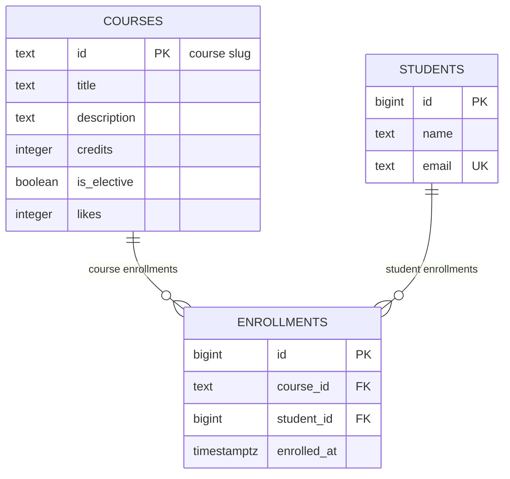

# course-catalog-db

PostgreSQL schema for the course catalog (Lab 6, "Advanced Web Technologies").

## How to run

PostgreSQL 16 or newer is required. Once, as the `postgres` superuser:

```sql
CREATE ROLE catalog_app LOGIN PASSWORD 'change-me';
CREATE DATABASE course_catalog OWNER catalog_app;
CREATE DATABASE idx_demo OWNER catalog_app;
CREATE DATABASE norm_demo OWNER catalog_app;
```

Then, from the project folder (it stops at the first error):

```bash
psql -h localhost -U catalog_app -d course_catalog -v ON_ERROR_STOP=1 -f schema.sql
psql -h localhost -U catalog_app -d course_catalog -v ON_ERROR_STOP=1 -f seed.sql
psql -h localhost -U catalog_app -d course_catalog -v ON_ERROR_STOP=1 -f queries.sql
```
The password change-me is for teaching purposes; real projects keep secrets out of git.

### Schema


The database consists of three main tables: courses, students, and enrollments. The enrollments table acts as a junction (many-to-many relationship) linking students to courses, where each student can enroll in multiple courses and each course can have multiple students.

## Constraint violation log

Commands were run with `\set VERBOSITY verbose`.

| # | What we violate | SQLSTATE | Constraint | API response |
|---|-----------------|----------|------------|--------------|
| 1 | NULL in courses.title | 23502 | `column "title"` (NOT NULL) | 422 Unprocessable Entity |
| 2 | courses.credits = 0 | 23514 | `courses_credits_check` | 422 Unprocessable Entity |
| 3 | courses.likes = -1 | 23514 | `courses_likes_check` | 500 Internal Server Error (Application bug) |
| 4 | a one-letter student name | 23514 | `students_name_check` | 422 Unprocessable Entity |
| 5 | a duplicate student email | 23505 | `students_email_key` | 409 Conflict |
| 6 | a duplicate course id | 23505 | `courses_pkey` | 409 Conflict |
| 7 | a repeated enrollment in a course | 23505 | `enrollments_course_id_student_id_key` | 409 Conflict |
| 8 | enrolling in a nonexistent course | 23503 | `enrollments_course_id_fkey` | 404 Not Found |
| 9 | enrolling a nonexistent student | 23503 | `enrollments_student_id_fkey` | 404 Not Found (or 422) |
| 10 | deleting a course with enrollments | 23001 | `enrollments_course_id_fkey` | 409 Conflict |
| 11 | deleting a student (cascade delete) | — | `enrollments_student_id_fkey` (CASCADE) | 204 No Content (Cascaded enrollments count: 6 → 3, restored to 6 after ROLLBACK) |


### Why check constraints in the database if Pydantic already checks them in code?

> Pydantic validates incoming user requests at the API application level. However, the database can be accessed and modified by other services, background jobs, raw SQL scripts, or database administrators directly. Enforcing constraints at the database level guarantees data integrity universally, regardless of the entry point.

## Index: EXPLAIN before and after

Query: `SELECT * FROM enrollments WHERE student_id = 777;`
Database `idx_demo`: 500 courses, 20,000 students, 50,000 enrollments.

| Metric | Before the index | After the index |
|---|------------------|-----------------|
| Access method | `Seq Scan` | `Bitmap Heap Scan` / `Bitmap Index Scan` |
| Cost | Higher (approx. 1042.00) | Lower (approx. 15.59) |
| Rows Removed by Filter | ~49,997 | 0 |
| Execution Time | Higher (~3.5 ms) | Sub-millisecond (~0.05 ms) |

### Before index plan:
```text
 Seq Scan on enrollments  (cost=0.00..1042.00 rows=3 width=34)
   Filter: (student_id = 777)
```

### After index plan:
```text
Bitmap Heap Scan on enrollments  (cost=4.31..15.59 rows=3 width=34)
   Recheck Cond: (student_id = 777)
   ->  Bitmap Index Scan on enrollments_student_id_idx  (cost=0.00..4.31 rows=3 width=0)
         Index Cond: (student_id = 777)
```

### Answers to questions:
1. **Why didn't PostgreSQL create an index on `enrollments.student_id` automatically?** 
   PostgreSQL automatically indexes Primary Keys and Unique constraints, but Foreign Keys are not automatically indexed because not all workloads require index-accelerated lookups on child references.
2. **Why does a primary-key lookup on `courses` (six rows) use `Seq Scan`, while on `enrollments` (50k rows) it goes through an index?** 
   With only 6 rows, the table fits entirely into a single data page. Sequential scanning of one page is faster than index tree traversal.
3. **Name two operations that an index on `student_id` will speed up:** 
   - Searching/filtering enrollments by a specific student.
   - Deleting a student with `ON DELETE CASCADE` (fast retrieval of child records).

## Design decisions

- **Why `courses.id` is text (slug) while `students.id` is an automatic number (`bigint`):** 
  Courses have natural, human-readable identifiers (slugs like `modern-frontend`) which make URLs clean and stable. Students require auto-incrementing surrogate keys because names and emails can change or contain duplicates.
- **Why `RESTRICT` on `enrollments.course_id` but `CASCADE` on `enrollments.student_id`:** 
  `RESTRICT` prevents deleting a course if active student enrollments exist, preserving academic history. `CASCADE` ensures that if a student profile is deleted, their associated enrollment records are automatically cleaned up, avoiding orphan rows.
- **Why `timestamptz` and `text` over alternatives:** 
  `timestamptz` automatically normalizes timestamps with timezones, best for global apps. `text` in modern PostgreSQL has no performance penalty compared to `varchar(n)` and avoids arbitrary length limits while supporting `CHECK` validation.

## Transaction

Scenario: enroll a new student in a course — two inserts in one transaction.

- The second insert failed due to a foreign key violation (`no-such-course`). The transaction entered an aborted state, and after `ROLLBACK`, the first insert (creating the student) was completely undone, leaving 0 new records. No partial operation occurred.
- Window B saw `0` rows before `COMMIT` and `1` row after `COMMIT` due to the `read committed` isolation level.
- Without a transaction, if the second insert had failed, the database would have been left with a dangling student record with no course enrollment, violating data consistency.

## Self-review against the checklist

| What to check | Result |
|---------------|--------|
| Keys | Yes — primary keys on all tables, foreign keys with appropriate RESTRICT/CASCADE. |
| Types | Yes — correct types (`text`, `bigint`, `integer`, `timestamptz`, `boolean`). |
| Required values | Yes — all mandatory fields marked as `NOT NULL`. |
| Constraints | Yes — domain rules enforced via `CHECK` and `UNIQUE` constraints. |
| Deletion | Yes — delete behavior (`RESTRICT` vs `CASCADE`) chosen deliberately. |
| Normalization | Yes — data properly normalized into three tables, avoiding update/delete anomalies. |
| Indexes and names | Yes — foreign keys and key columns indexed, consistent `snake_case` naming. |

## Bonus

### Task 1: Normalization and 3 Anomalies
We experimented with a flat `registrations` table containing duplicated student and course data, and observed three classic database anomalies:
- **Update Anomaly:** Renaming a course title in a single row leaves the database in an inconsistent state where the same course has multiple titles.
- **Delete Anomaly:** Deleting the only enrollment for a course causes the course details to disappear completely, because they lived only inside the enrollment rows.
- **Insert Anomaly:** Adding a course with no enrollments requires storing an empty/null student placeholder. 

**How normalization fixes them:** Splitting the data into normalized tables (`students`, `courses`, and `enrollments`) removes data duplication. Courses (including those with zero enrollments, such as `api-design`, `databases-postgresql`, and `web-security`) now live safely in their own table, completely independent of whether students are currently enrolled.

### Task 2: Lost Update and Row Locks
- **The Problem:** In a "read — compute in program — write back" scheme, two clients read the same value (e.g., `11`), independently calculate `12`, and write it back. As a result, two operations result in a net increase of only 1 (value becomes `12` instead of `13`), causing a **lost update**.
- **The Solution (`UPDATE ... SET likes = likes + 1`)**: Executing the increment directly inside the database engine ensures atomicity. When Window A holds an active transaction modifying the row, Window B's update statement automatically waits (blocks) via a **row-level lock** until A commits. Once released, B re-reads the fresh value (`12`), adds one, and correctly saves `13`.

### Task 3: SQL Injection and Prepared Statements
- **Vulnerability of Concatenation:** If user input is directly concatenated into a SQL string, malicious payloads like `'x' OR '1'='1'` alter the query logic, turning the condition into a tautology that bypasses authentication and returns all rows.
- **Safety of Prepared Statements / Parameters:** When using parameters or prepared statements (`PREPARE` / `EXECUTE`), the database engine treats the entire input strictly as a literal data value, never as executable SQL syntax. Searching for `x' OR '1'='1'` looks for a course literal matching that exact string, safely returning 0 rows.

### Task 4: Additional Queries
- **Query 7 (Courses without enrollments):** Uses a `LEFT JOIN` on `enrollments` paired with `WHERE e.id IS NULL` to isolate courses that have no active student references.
- **Query 8 (Active students):** Uses `GROUP BY` combined with `HAVING count(*) > 1` to filter and return students enrolled in more than one course, ordered by course count descending.

### Task 5: Live Schema Migration (`ALTER TABLE`)
To enforce that a student's email must contain an `@` sign without wiping the existing database, we applied a live constraint:
```sql
ALTER TABLE students ADD CONSTRAINT students_email_format CHECK (position('@' IN email) > 1);
```

The database verifies all existing rows first and rejects the operation if any row violates the rule. This same rule has now been added directly to schema.sql for future deployments.